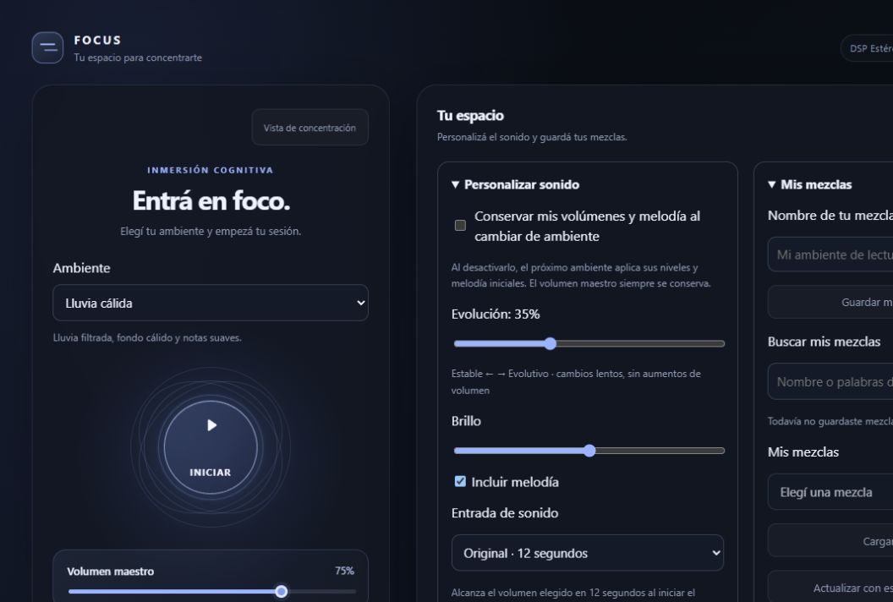

# FOCUS Studio — Paisaje sonoro procedural

PWA de seis ambientes para concentración y estudio, sintetizados localmente con Web Audio API. No utiliza grabaciones MP3/WAV ni streaming de audio. El motor no carga librerías de audio externas; el repositorio sí incluye dependencias npm para desarrollo, compilación y pruebas.

[Demo en vivo](https://nitsugaone.github.io/FOCUS-studio/) · [Arquitectura](docs/ARCHITECTURE.md) · [Pruebas](docs/PRUEBAS-AUTOMATICAS.md) · [Licencia MIT](LICENSE)

## Ambientes y sesiones

- Lluvia cálida, océano profundo, espacio, cubrir conversaciones, fogón suave y viento entre hojas.
- Evolución, brillo, melodía, amplitud estéreo, balance y niveles de maestro, textura, drone y notas.
- Sesión libre, duración de 1 a 180 minutos y ciclos guiados con descansos. El avance entre tramos requiere una acción explícita.
- Entrada y cierre graduales, prolongación de sesiones individuales y recuperación del progreso sin reproducción automática.
- Hasta 50 mezclas locales con búsqueda, favoritas, duplicación y recuperación de la última eliminación.
- Enlaces para compartir ajustes y copias JSON para exportar, importar y recuperar datos.
- Historial de escucha y hasta 200 valoraciones personales; no son mediciones automáticas de concentración.

## Captura real de la interfaz



Detalle capturado del sitio publicado en un navegador de escritorio el 6 de noviembre de 2026, en pausa y sin datos personales. Es una captura de interfaz, no una prueba de audio ni de un dispositivo físico. Las ilustraciones SVG de `docs/screenshots/` y los PNG generados por `scripts/generate_assets.py` son maquetas; no se presentan como capturas reales.

## Audio y arquitectura

La entrada oficial es `index.html` → `src/main.js`, con módulos ES6 en `src/`. `FocusController` compone servicios y controladores; `FocusAudioEngine` posee el grafo y no accede al DOM ni al almacenamiento. Véanse los [contratos y responsabilidades](docs/ARCHITECTURE.md).

Hay tres buses de mezcla —textura, drone y notas— además del maestro. Cada ambiente combina sus ramas de forma distinta:

- **Textura:** ruido marrón y blanco estéreo, filtrado y modulado; viento con ráfagas y una rama independiente de crepitaciones. Fogón suave silencia las capas continuas y deja las crepitaciones.
- **Drone:** tres osciladores con afinación según el ambiente, filtrado y paneo. No es una garantía de estimulación binaural.
- **Notas:** osciladores con armónico y envío a reverberación convolutiva generada en el navegador. Su selección y afinación dependen del ambiente y la evolución.
- **Salida:** entrada/cierre de sesión, amplitud estéreo, balance y compresor. El grafo se crea al iniciar audio, no al abrir la página.

La selección de notas usa grados pentatónicos menores relativos a la raíz del ambiente. La frecuencia real se calcula como `raíz × multiplicador`, con los multiplicadores `[2, 2.378414, 2.66968, 3, 3.563595, 4, 4.756828]`. No hay una única lista fija de frecuencias para los seis ambientes.

`AudioWorklet` genera ruido y crepitaciones de forma continua; si no está disponible o falla su carga se usan buffers sintetizados de respaldo. La carpeta `audio/` contiene el programa `noise-processor.js`, no grabaciones.

### Segundo plano y pantalla bloqueada

El motor conecta su salida a un `MediaStreamAudioDestinationNode`; `PlaybackController` entrega ese stream al elemento `<audio id="bg-audio">`. Media Session y Wake Lock se usan cuando el navegador los ofrece. Esta estrategia no garantiza continuidad en todos los sistemas.

Las pruebas de navegador automatizadas cubren Chromium y WebKit en Linux. No equivalen a teléfonos físicos ni prueban el bloqueo real de pantalla. El usuario informó pruebas manuales en celulares Android y PC, todas desde navegador web. El [registro de validación](docs/VALIDACION-V3.md) conserva ese alcance; los modelos, versiones y navegadores no fueron informados. No se atribuyen resultados a una PWA instalada.

## Instalación y ejecución local

### Ruta oficial: módulos nativos

GitHub Pages publica el HTML de la raíz y sus módulos nativos. Para reproducir esa ruta no se necesita compilar ni instalar paquetes npm.

Requisitos: navegador moderno con Web Audio API y módulos ES6; servidor HTTP local. Service Worker y AudioWorklet requieren HTTPS o `localhost`. La disponibilidad de las APIs opcionales depende del navegador.

```sh
git clone https://github.com/nitsugaone/FOCUS-studio.git
cd FOCUS-studio
python -m http.server 8080
```

Abrir [http://localhost:8080/](http://localhost:8080/). Se requiere Python 3 para ese comando; puede sustituirse por otro servidor HTTP estático.

### Ruta alternativa: Vite

El build es una distribución alternativa verificada en CI; no es lo que publica actualmente Pages. Node 24 es la versión usada por CI.

```sh
npm ci --ignore-scripts --no-audit --no-fund
npm run dev
```

Para producir y comprobar el build con la subruta del sitio:

```sh
npm run build -- --base=/FOCUS-studio/
node scripts/validate-build.mjs
npm run preview
```

Vite informa la dirección local al iniciar. El build queda en `dist/`; no mezclar sus archivos con los módulos fuente. El scaffold React/TypeScript sigue en el repositorio y sus paquetes en el lockfile, pero `src/main.tsx` no es la entrada del HTML oficial.

## Pruebas

Desde la raíz:

```sh
node --test tests/*.test.mjs
```

La suite Node funciona sin instalar las dependencias del build. Para probar también compilación y recursos offline:

```sh
npm ci --ignore-scripts --no-audit --no-fund
npm run build -- --base=/FOCUS-studio/
node scripts/validate-build.mjs
```

Pruebas de navegador, desde `tools/browser-tests/`:

```sh
npm ci --ignore-scripts --no-audit --no-fund
npx playwright install chromium webkit
npm test
```

El destino predeterminado es fuente. Para probar `dist/`, que debe existir, establecer `FOCUS_TEST_TARGET=build` antes de `npm test`: en PowerShell, `$env:FOCUS_TEST_TARGET = 'build'`; en una shell POSIX, `FOCUS_TEST_TARGET=build npm test`.

La [CI](.github/workflows/quality.yml) ejecuta las 29 suites Node, el build Vite, su comprobación offline y los mismos 210 casos de navegador contra fuente y build (420 ejecuciones en seis perfiles). Consulte [la guía de pruebas](docs/PRUEBAS-AUTOMATICAS.md) y [el protocolo de escucha](docs/VALIDACION-V3.md). Las pruebas automatizadas no verifican la calidad percibida, la fatiga ni el bloqueo de un teléfono físico.

## PWA, actualizaciones y despliegue

La [demo pública](https://nitsugaone.github.io/FOCUS-studio/) usa la raíz de `main` en GitHub Pages, sin paso de build Vite. Las rutas relativas del manifest, módulos y worklet permiten el subdirectorio `/FOCUS-studio/`.

El worker usa Cache-First y la caché fuente versionada `focus-audio-v3.65`. Al activarse elimina solo las cachés antiguas con prefijo `focus-audio-`. La interfaz avisa si hay una versión en espera; hay que pausar y aplicar la actualización. Primero guarda la sesión, luego solicita `SKIP_WAITING` y recarga al cambiar de worker. La instalación por sí sola no fuerza un cambio durante la escucha.

El build Vite genera su propio precaché con los archivos realmente emitidos y una versión derivada de su contenido. `sw.js` y `public/sw.js` conservan la misma plantilla fuente. La disponibilidad offline requiere haber cargado y precacheado la aplicación online.

## Instalación como Progressive Web App (PWA)

### Escritorio (Chrome, Edge, Brave)
1. Abrir la URL en el navegador.
2. Hacer clic en el ícono de **Instalar aplicación** ubicado en el extremo derecho de la barra de direcciones.
3. Confirmar la instalación. La aplicación se ejecutará en una ventana independiente sin controles de navegación del explorador.

### Android (Chrome)
1. Abrir la URL en Chrome para Android.
2. Presionar el menú contextual de tres puntos en la esquina superior derecha.
3. Seleccionar **Instalar aplicación** o **Agregar a la pantalla principal**.
4. La aplicación creará un acceso directo con ícono adaptativo (*maskable*).

### iOS / iPadOS (Safari)
1. Abrir la aplicación en Safari.
2. Tocar el botón de **Compartir** en la barra inferior.
3. Desplazarse hacia abajo y seleccionar **Agregar al inicio**.
4. Abrir la app desde el icono en la pantalla de inicio para ejecutar en modo pantalla completa sin barra de navegación.


## Atajos de teclado

| Tecla | Acción |
| --- | --- |
| `Espacio` | Iniciar o pausar fuera de controles editables o interactivos. |
| `M` | Silenciar o restaurar el maestro, con la misma exclusión de controles. |
| `Escape` | Salir de la vista de concentración y devolver el foco a su botón. |
| `Tab` / `Mayús+Tab` | Navegación de foco estándar del navegador; no es un atajo registrado por la app. |

Espacio y M ignoran repeticiones de tecla. La vista de concentración se activa desde su botón; Escape la cierra.

## Uso de los controles

### Fogón suave

Crepitaciones estéreo suaves e irregulares de leña, sin cama continua de ruido marrón, blanco o viento. Al elegirlo aplica textura al 68%, sin drone ni melodía; «Conservar mi mezcla» mantiene los niveles y la melodía actuales. Las crepitaciones se generan continuamente con AudioWorklet y usan un bucle estéreo de respaldo cuando no está disponible. Se puede guardar, compartir y exportar en copias de seguridad como los demás ambientes. La textura comparte el control de volumen ambiental y la amplitud estéreo.

### Viento entre hojas

Brisa aireada formada por ruido estéreo filtrado entre graves y agudos, con un fondo grave tenue. Dos osciladores de control generan las ráfagas dentro del motor de audio, sin depender de los temporizadores de pantalla. Varían lentamente según Evolución; al 0% la brisa mantiene una intensidad estable. Brillo ajusta el contenido agudo. Comparte el volumen de textura ambiental y la amplitud estéreo, sin agregar archivos de audio. Al elegirlo aplica textura al 70%, sin drone ni melodía, y respeta «Conservar mi mezcla». Compatible con mezclas, favoritos, enlaces, valoraciones, copias de seguridad y reproducción sin conexión.

### Cierre de sesiones con pantalla inactiva

El cierre elegido (5, 20 o 60 segundos, limitado a la mitad de los tramos cortos) se programa en el motor de audio al iniciar y reanudar. El volumen llega a cero al completar la duración aunque se suspendan los temporizadores de la pantalla; el modo libre mantiene la reproducción continua. Al volver a la app se actualizan el estado y el historial hasta el final del tramo, sin contabilizar tiempo posterior ni avanzar automáticamente al siguiente tramo. La pausa conserva el tiempo restante. Las pruebas automatizadas incluyen salida de audio con temporizadores detenidos y renderizado Web Audio del cierre; la compatibilidad física depende del navegador y del dispositivo.

### Balance entre canales

Control de izquierda a derecha (−100 a 100) con botón para volver al centro. Se aplica después de la amplitud estéreo, también al centrar la mezcla, y reduce el canal contrario sin aumentar los niveles de entrada. Los cambios son suaves y no reinician el motor ni el reloj. El balance se conserva en ajustes, mezclas, favoritos, enlaces y copias de seguridad. Los datos anteriores usan 0 (centro); las mezclas con diferente balance se conservan por separado al importar. Las pruebas incluyen renderizado Web Audio estéreo y mono, combinación con amplitud estéreo, límites de señal y portabilidad.

### Entrada de sonido

La entrada adicional puede ser directa, rápida (3 segundos), original (12 segundos) o lenta (30 segundos). Las entradas graduales parten del 40% del volumen elegido y alcanzan el 100%; no modifican los controles de volumen. La opción original conserva la curva anterior. Se programa en el motor de audio para continuar sin temporizadores de pantalla. Al pausar y reanudar conserva el progreso; reiniciar el reloj vuelve a comenzar la entrada con una transición breve y suave. Se elige en pausa y también funciona en modo libre. Los descansos en silencio permanecen silenciados. Las mezclas, los enlaces y las copias guardan la opción; los datos anteriores usan la entrada original.

### Prolongar una sesión

El botón «+5 min» añade tiempo a una sesión individual con duración, en reproducción o en pausa, antes de que termine. Conserva el tiempo transcurrido, el historial de escucha, los volúmenes, la entrada y el sonido. Actualiza el cierre de audio sin recrear las fuentes. Cerca del máximo de 180 minutos añade solo el margen disponible y muestra el incremento real. No se ofrece en modo libre ni en ciclos guiados, y no reactiva sesiones ya terminadas. La duración ampliada se conserva en la recuperación de sesión, las mezclas, los enlaces y las copias de seguridad mediante los campos existentes.

### Buscar mezclas guardadas

El buscador filtra por nombre la lista de mezclas y los accesos a favoritas. Ignora mayúsculas y tildes, y admite varias palabras en cualquier orden. Muestra cuántas mezclas coinciden y permite limpiar la búsqueda; sin resultados, las acciones de mezcla quedan desactivadas. Buscar no modifica datos ni interrumpe el sonido. Cargar una mezcla conserva la protección de la sesión activa. Al guardar o renombrar se limpia el filtro para mostrar la mezcla resultante. La búsqueda es temporal y se borra al recargar; no cambia los formatos de enlaces ni copias de seguridad.

### Duplicar una mezcla

«Duplicar mezcla guardada» crea una variante de la mezcla seleccionada, conservando sus ajustes y volúmenes guardados. No toma los ajustes que estén sonando ni cambia la reproducción. Genera un nombre con «(copia)», «(copia 2)», etc., sin superar los 60 caracteres de los nombres y sin cortar caracteres Unicode. La copia se guarda sin marcar como favorita, queda seleccionada y se muestra aunque hubiera una búsqueda activa. Se puede renombrar o cargar en pausa para editar su sonido. Mantiene el límite de 50 mezclas y los formatos de copia de seguridad y enlaces existentes.

### Deshacer la última eliminación

Después de eliminar una mezcla aparece «Deshacer eliminación». Recupera sus ajustes, nombre, marca de favorita y posición, sin cargarla ni cambiar el audio o el reloj. También funciona mientras estás escuchando y aunque una búsqueda no tenga resultados. Se conserva solo la última eliminación en esta página: guardar, actualizar, renombrar, duplicar o cambiar favoritas deja atrás esa posibilidad; recargar también la descarta. Una operación que no se puede guardar no descarta la recuperación pendiente. La eliminación y la recuperación actualizan la biblioteca guardada; la posibilidad de deshacer no se incluye en las copias de seguridad ni cambia su formato.

### Compartir desde el celular

Al crear un enlace, «Compartir enlace…» abre el menú del sistema cuando el navegador ofrece Web Share. Permite elegir entre las aplicaciones disponibles. Se comparte únicamente el enlace generado con los ajustes de sonido y sesión, sin nombres de mezclas, historial ni progreso. Cancelar conserva el enlace; si falla el menú, se puede usar «Copiar enlace» o copiarlo manualmente. El botón de copiar permanece disponible también en navegadores sin Web Share. Compartir no cambia el audio ni guarda cambios en la biblioteca.

### Vista previa de mezclas guardadas

Seleccionar una mezcla muestra un resumen de los datos guardados: nombre, ambiente, melodía, duración o ciclo, tipo de descanso y niveles de maestro, textura, drone y notas. El resumen se actualiza al guardar cambios, duplicar o deshacer una eliminación, y desaparece si no hay selección o la búsqueda la oculta. Permite revisar una mezcla mientras suena otra, sin cambiar el audio, el reloj ni el almacenamiento. Para aplicarla se sigue usando «Cargar» en pausa. Las mezclas antiguas sin duración o plan se muestran como sesión libre, igual que al cargarlas.

## Estructura del repositorio

```text
FOCUS-studio/
├── index.html             # HTML/CSS; carga src/main.js
├── src/
│   ├── main.js            # Entrada oficial
│   ├── audio/             # Motor, DSP y datos de seis ambientes
│   ├── storage/           # Persistencia, mezclas, informes y copias
│   ├── session/           # Reloj, ciclos, progreso y enlaces
│   ├── ui/                # Controladores y vistas
│   └── *.tsx, index.css   # Scaffold React/TypeScript, fuera de la entrada oficial
├── audio/                 # Procesador AudioWorklet en JavaScript; sin audio grabado
├── tests/                 # Suites Node y adaptadores de prueba
├── tools/browser-tests/   # Playwright, configuración, casos y lockfile
├── scripts/               # Servidor de pruebas, hook offline, validación y generación de maquetas
├── public/                # Recursos copiados al build; incluye copia del worklet y worker
├── icons/                 # Iconos de instalación
├── screenshots/           # PNG de maqueta referenciados por el manifest
├── docs/                  # Arquitectura, pruebas, guías e imágenes
├── .github/workflows/     # CI de calidad; Pages publica la raíz de main
├── manifest.json
├── sw.js
├── vite.config.ts
├── package.json
├── package-lock.json
├── tsconfig.json
└── LICENSE
```

## Contribuciones

Conservar los contratos de audio, selectores, eventos, formatos de enlaces y copias, y funcionamiento offline. Enviar cambios con las comprobaciones Node, build y navegador indicadas arriba. Documentar por separado cualquier evaluación realizada en dispositivos físicos.

## Licencia

Distribuido bajo la licencia MIT. Consulte [LICENSE](LICENSE).
