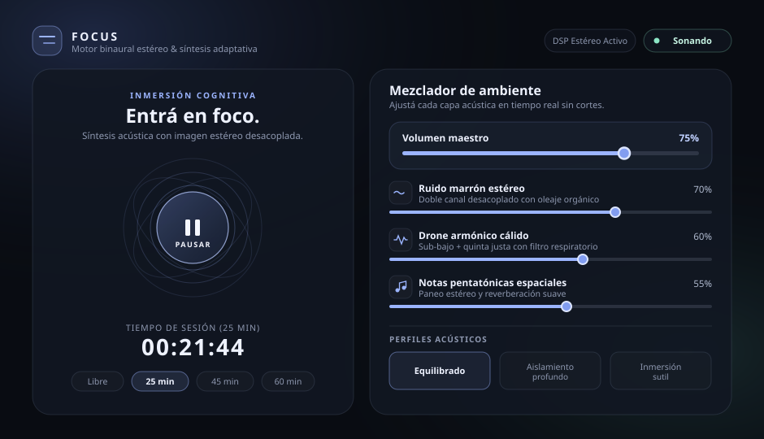
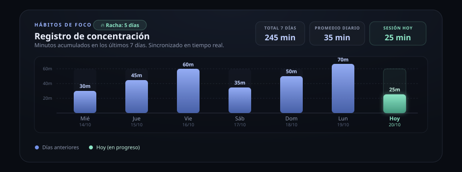

# Focus — Paisaje Sonoro Procedural

Aplicación web progresiva (PWA) de alto rendimiento para síntesis acústica procedural en tiempo real orientada a la concentración profunda, estudio e inmersión cognitiva. Funciona de manera 100% autónoma en el navegador del cliente mediante la Web Audio API, sin dependencias externas, sin librerías de terceros y sin consumir archivos de audio pregrabados (MP3, WAV o streaming).

[](LICENSE)
[](https://developer.mozilla.org/en-US/docs/Web/Progressive_web_apps)
[](https://www.w3.org/TR/webaudio/)
[]()

---

## FOCUS Studio v3 — ambientes y sesiones

- Seis ambientes procedurales: lluvia cálida, océano profundo, espacio, textura para cubrir conversaciones, fogón suave y viento entre hojas.
- Control de evolución (0–100), brillo y melodía independiente; filtros y afinación con transiciones suaves.
- Mezclas personales con nombre, volúmenes, ambiente, evolución, brillo, melodía y duración. Hasta 50 mezclas locales.
- Entrada gradual seleccionable: directa, rápida (3 s), original (12 s) o lenta (30 s), con cierre gradual seleccionable para sesiones con duración.
- Valoración opcional al completar una sesión con duración; se conservan hasta 200 valoraciones locales.
- El historial nuevo empieza en cero; no se borran historiales existentes.
- Los perfiles acústicos anteriores siguen disponibles como ajustes de volumen del ambiente seleccionado.

### Validación

Ejecutar `node tests/studio.test.mjs` desde la raíz. Comprueba inicio del grafo simulado, cuatro ambientes, afinaciones, persistencia, protección de la sesión activa y ausencia de historial ficticio. No verifica salida acústica ni compatibilidad real del navegador.

Antes de integrar: seguir [la guía de escucha y móviles](docs/VALIDACION-V3.md). La calidad percibida, el volumen equivalente entre ambientes y la continuidad al bloquear el teléfono requieren pruebas reales.

## Capturas de Pantalla


*Figura 1: Interfaz principal con animaciones orbitales sincronizadas y controles táctiles.*


*Figura 2: Mezclador de capas DSP en tiempo real y gráfico de hábitos de foco.*

---

## Características Principales

- **Síntesis 100% Procedural Local:** Todos los sonidos se calculan matemáticamente en tiempo real en la CPU del cliente. Sin descargas de audio para reproducir.
- **Cero Telemetría y Cero Streaming:** Privacidad absoluta; no realiza peticiones de red para reproducir sonido ni almacena datos en servidores externos.
- **Arquitectura DSP de Tres Capas:**
  - **Ruido Marrón Estéreo Desacoplado:** Generado en un `AudioBuffer` de 2 canales independientes con modulación LFO senoidal en filtro pasa-bajos.
  - **Drone Armónico Binaural:** Osciladores de sub-frecuencia fundamental y quinta justa con paneo balanceado y barrido orgánico de frecuencias.
  - **Campanas Pentatónicas Espaciales:** Generación estocástica sobre la escala de La menor pentatónica procesada a través de un bus de reverberación convolutiva algorítmica (`ConvolverNode`).
- **Control Dinámico Maestro:** Etapa final con `DynamicsCompressorNode` para prevenir recorte digital (*clipping*) y unificar la presión acústica.
- **Persistencia de Audio en Segundo Plano (Móviles):** Integración de `MediaStreamAudioDestinationNode` vinculado a un elemento HTML5 Audio para evitar que el sistema operativo suspenda el hilo de audio al bloquear la pantalla.
- **Soporte de Controles Multimedia:** Compatibilidad nativa con la `Media Session API` (pantalla de bloqueo, centro de control y botones físicos en auriculares Bluetooth).
- **Prevención de Suspensión de Pantalla:** Integración segura con la `Screen Wake Lock API` durante la reproducción activa.
- **Temporizador Inmune a Throttling:** Lógica de reloj basada en diferenciales de `Date.now()`, manteniendo la precisión temporal aun cuando el navegador inactive los hilos de fondo.
- **Preparado para PWA y APK:** Manifiesto estándar con íconos vectoriales embebidos en Data URI y Service Worker con estrategia de caché *Cache-First* para operación offline total.

---

## Arquitectura Técnica de Audio (DSP)

El grafo de audio se instancia de forma perezosa (*lazy*) tras la primera interacción del usuario para cumplir con las políticas de autoplay de los navegadores modernos:

```
[Ruido Marrón BufferSource (L/R)] ──> [BiquadFilter LP] ──> [Gain: Noise] ──┐
             ▲ (Modulado por LFO 0.065Hz)                                   │
                                                                            │
[Osciladores Drone (55Hz, 110Hz, 165Hz)] ──> [StereoPanner] ──> [LP Filter] ──> [Gain: Drone] ─┼──> [Gain: Master] ──> [Gain: Fade] ──> [DynamicsCompressor] ──┬─> ctx.destination (Parlantes)
                                                                            │                                                                                │
[Generador Pentatónico (Osc + Harm)] ──> [StereoPanner] ──┬────────────────> [Gain: Notes] ─┘                                                                                └─> MediaStreamDestination ─> <audio>
                                                          └─> [ConvolverNode (Reverb)] ─┘
```

1. **Buffer de Ruido Marrón:** Algoritmo de integración acumulativa de ruido blanco normalizado y bucleado con un crossfade senoidal de fase continua de 1.5 segundos.
2. **Reverberación Convolutiva:** Impulso estéreo sintetizado algorítmicamente calculando caídas exponenciales y dispersión paso-bajos aleatoria para eliminar coloraciones metálicas.
3. **Escala Musical:** Matriz pentatónica menor afinada en frecuencias fundamentales exactas:
   $$\{164.81\,\text{Hz}, 220.00\,\text{Hz}, 261.63\,\text{Hz}, 293.66\,\text{Hz}, 329.63\,\text{Hz}, 392.00\,\text{Hz}, 440.00\,\text{Hz}\}$$

---

## Estructura del Repositorio

El proyecto está diseñado bajo una arquitectura modular y ligera, lista para servirse como sitio estático o empaquetarse en contenedores híbridos:

```
├── index.html        # Aplicación principal (HTML5, CSS3, DSP Engine)
├── manifest.json     # Manifiesto PWA compatible con PWABuilder (icons, screenshots, categories)
├── sw.js             # Service Worker con estrategia Cache-First (pre-cache de iconos y screenshots)
├── icons/            # Iconos PNG requeridos para tiendas e instalación PWA
│   ├── icon-192.png
│   ├── icon-512.png
│   ├── icon-maskable-512.png
│   └── apple-touch-icon.png
├── screenshots/      # Capturas PNG (desktop y mobile) para validación de PWABuilder
│   ├── screenshot-desktop.png
│   └── screenshot-mobile.png
├── docs/             # Recursos de documentación
│   └── screenshots/
│       ├── hero-preview.svg
│       └── mixer-preview.svg
├── LICENSE           # Licencia MIT
└── README.md         # Documentación del proyecto
```

---

## Instalación y Ejecución Local

Dado que la aplicación está construida en JavaScript estándar sin transpiladores requeridos, cualquier servidor HTTP estático es suficiente.

### Prerrequisitos
Un navegador web moderno con soporte para Web Audio API (Chrome 66+, Firefox 60+, Safari 14.1+, Edge 79+).

### Pasos

1. Clonar el repositorio:
   ```bash
   git clone https://github.com/username/focus-soundscape.git
   cd focus-soundscape
   ```

2. Iniciar un servidor HTTP local (los Service Workers requieren contexto seguro o `localhost`):

   - **Opción con Python 3:**
     ```bash
     python3 -m http.server 8080
     ```

   - **Opción con Node.js (`npx serve`):**
     ```bash
     npx serve .
     ```

   - **Opción con extensiones de IDE:**
     Usar *Live Server* de Visual Studio Code sobre la carpeta raíz.

3. Abrir en el navegador:
   ```
   http://localhost:8080
   ```

---

## Despliegue en GitHub Pages

1. Subir el proyecto a un repositorio en GitHub.
2. En el panel de control del repositorio, ingresar a **Settings** > **Pages**.
3. En la sección **Build and deployment**:
   - **Source**: `Deploy from a branch`
   - **Branch**: `main` (o `master`) y carpeta `/ (root)`
4. Guardar los cambios.
5. Tras unos segundos, la URL pública estará disponible bajo el formato:
   ```
   https://<tu-usuario>.github.io/<nombre-del-repo>/
   ```
   El Service Worker y el archivo `manifest.json` utilizan rutas relativas (`./`), garantizando compatibilidad inmediata en subdirectorios de GitHub Pages.

---

## Instalación como Progressive Web App (PWA)

### Escritorio (Chrome, Edge, Brave)
1. Abrir la URL en el navegador.
2. Hacer clic en el ícono de **Instalar aplicación** ubicado en el extremo derecho de la barra de direcciones.
3. Confirmar la instalación. La aplicación se ejecutará en una ventana independiente sin controles de navegación del explorador.

### Android (Chrome)
1. Abrir la URL en Chrome para Android.
2. Presionar el menú contextual de tres puntos en la esquina superior derecha.
3. Seleccionar **Instalar aplicación** o **Agregar a la pantalla principal**.
4. La aplicación creará un acceso directo con ícono adaptativo (*maskable*).

### iOS / iPadOS (Safari)
1. Abrir la aplicación en Safari.
2. Tocar el botón de **Compartir** en la barra inferior.
3. Desplazarse hacia abajo y seleccionar **Agregar al inicio**.
4. Abrir la app desde el icono en la pantalla de inicio para ejecutar en modo pantalla completa sin barra de navegación.

---

## Conversión a APK / Android Bundle con PWABuilder

La estructura de `manifest.json` y `sw.js` cumple con los criterios de calidad PWA exigidos por Google Play Store mediante Trusted Web Activity (TWA):

1. Ingresar a [PWABuilder.com](https://www.pwabuilder.com/).
2. Ingresar la URL pública de la aplicación (por ejemplo, el enlace generado en GitHub Pages con protocolo HTTPS).
3. Hacer clic en **Start** y esperar el análisis del manifest y Service Worker.
4. Una vez aprobado el puntaje de PWA, hacer clic en **Package for Stores**.
5. Seleccionar la plataforma **Android**:
   - Configurar el *Package Name* (ejemplo: `app.focus.soundscape`).
   - Configurar el código de versión y nombre de versión.
   - Habilitar soporte de pantalla completa y firmas de claves.
6. Hacer clic en **Generate APK / AAB** para descargar el paquete listo para pruebas locales o publicación directa en Google Play Console.

---

## Atajos de Teclado

| Tecla | Acción |
| :--- | :--- |
| `Espacio` | Iniciar / Pausar reproducción |
| `M` | Silenciar / Restaurar volumen maestro |
| `Tab` | Navegar entre controles deslizantes y perfiles |

---

## Contribuciones

Las contribuciones son bienvenidas. Si deseas colaborar con el proyecto:

1. Realiza un Fork del repositorio.
2. Crea una rama para tu función o corrección:
   ```bash
   git checkout -b feature/nueva-mejora
   ```
3. Realiza tus cambios asegurando no romper la calibración del grafo acústico ni degradar la compatibilidad offline.
4. Envía un Pull Request detallando los cambios introducidos y las pruebas realizadas en navegadores de escritorio y móviles.

---

## Licencia

Este proyecto está distribuido bajo los términos de la Licencia MIT. Consulta el archivo [LICENSE](LICENSE) para obtener más detalles.


## Fogón suave

Ambiente de fondo grave con crepitaciones estéreo suaves e irregulares. Al elegirlo aplica textura al 68%, sin drone ni melodía; «Conservar mi mezcla» mantiene los niveles y la melodía actuales. Las crepitaciones se generan continuamente con AudioWorklet y usan un bucle estéreo de respaldo cuando no está disponible. Se puede guardar, compartir y exportar en copias de seguridad como los demás ambientes. La textura comparte el control de volumen ambiental y la amplitud estéreo.


## Viento entre hojas

Brisa aireada formada por ruido estéreo filtrado entre graves y agudos, con un fondo grave tenue. Dos osciladores de control generan las ráfagas dentro del motor de audio, sin depender de los temporizadores de pantalla. Varían lentamente según Evolución; al 0% la brisa mantiene una intensidad estable. Brillo ajusta el contenido agudo. Comparte el volumen de textura ambiental y la amplitud estéreo, sin agregar archivos de audio. Al elegirlo aplica textura al 70%, sin drone ni melodía, y respeta «Conservar mi mezcla». Compatible con mezclas, favoritos, enlaces, valoraciones, copias de seguridad y reproducción sin conexión.


## Cierre de sesiones con pantalla inactiva

El cierre elegido (5, 20 o 60 segundos, limitado a la mitad de los tramos cortos) se programa en el motor de audio al iniciar y reanudar. El volumen llega a cero al completar la duración aunque se suspendan los temporizadores de la pantalla; el modo libre mantiene la reproducción continua. Al volver a la app se actualizan el estado y el historial hasta el final del tramo, sin contabilizar tiempo posterior ni avanzar automáticamente al siguiente tramo. La pausa conserva el tiempo restante. Las pruebas automatizadas incluyen salida de audio con temporizadores detenidos y renderizado Web Audio del cierre; la compatibilidad física depende del navegador y del dispositivo.


## Balance entre canales

Control de izquierda a derecha (−100 a 100) con botón para volver al centro. Se aplica después de la amplitud estéreo, también al centrar la mezcla, y reduce el canal contrario sin aumentar los niveles de entrada. Los cambios son suaves y no reinician el motor ni el reloj. El balance se conserva en ajustes, mezclas, favoritos, enlaces y copias de seguridad. Los datos anteriores usan 0 (centro); las mezclas con diferente balance se conservan por separado al importar. Las pruebas incluyen renderizado Web Audio estéreo y mono, combinación con amplitud estéreo, límites de señal y portabilidad.


## Entrada de sonido

La entrada adicional puede ser directa, rápida (3 segundos), original (12 segundos) o lenta (30 segundos). Las entradas graduales parten del 40% del volumen elegido y alcanzan el 100%; no modifican los controles de volumen. La opción original conserva la curva anterior. Se programa en el motor de audio para continuar sin temporizadores de pantalla. Al pausar y reanudar conserva el progreso; reiniciar el reloj vuelve a comenzar la entrada con una transición breve y suave. Se elige en pausa y también funciona en modo libre. Los descansos en silencio permanecen silenciados. Las mezclas, los enlaces y las copias guardan la opción; los datos anteriores usan la entrada original.


## Prolongar una sesión

El botón «+5 min» añade tiempo a una sesión individual con duración, en reproducción o en pausa, antes de que termine. Conserva el tiempo transcurrido, el historial de escucha, los volúmenes, la entrada y el sonido. Actualiza el cierre de audio sin recrear las fuentes. Cerca del máximo de 180 minutos añade solo el margen disponible y muestra el incremento real. No se ofrece en modo libre ni en ciclos guiados, y no reactiva sesiones ya terminadas. La duración ampliada se conserva en la recuperación de sesión, las mezclas, los enlaces y las copias de seguridad mediante los campos existentes.


## Buscar mezclas guardadas

El buscador filtra por nombre la lista de mezclas y los accesos a favoritas. Ignora mayúsculas y tildes, y admite varias palabras en cualquier orden. Muestra cuántas mezclas coinciden y permite limpiar la búsqueda; sin resultados, las acciones de mezcla quedan desactivadas. Buscar no modifica datos ni interrumpe el sonido. Cargar una mezcla conserva la protección de la sesión activa. Al guardar o renombrar se limpia el filtro para mostrar la mezcla resultante. La búsqueda es temporal y se borra al recargar; no cambia los formatos de enlaces ni copias de seguridad.


## Duplicar una mezcla

«Duplicar mezcla guardada» crea una variante de la mezcla seleccionada, conservando sus ajustes y volúmenes guardados. No toma los ajustes que estén sonando ni cambia la reproducción. Genera un nombre con «(copia)», «(copia 2)», etc., sin superar los 60 caracteres de los nombres y sin cortar caracteres Unicode. La copia se guarda sin marcar como favorita, queda seleccionada y se muestra aunque hubiera una búsqueda activa. Se puede renombrar o cargar en pausa para editar su sonido. Mantiene el límite de 50 mezclas y los formatos de copia de seguridad y enlaces existentes.


## Deshacer la última eliminación

Después de eliminar una mezcla aparece «Deshacer eliminación». Recupera sus ajustes, nombre, marca de favorita y posición, sin cargarla ni cambiar el audio o el reloj. También funciona mientras estás escuchando y aunque una búsqueda no tenga resultados. Se conserva solo la última eliminación en esta página: guardar, actualizar, renombrar, duplicar o cambiar favoritas deja atrás esa posibilidad; recargar también la descarta. Una operación que no se puede guardar no descarta la recuperación pendiente. La eliminación y la recuperación actualizan la biblioteca guardada; la posibilidad de deshacer no se incluye en las copias de seguridad ni cambia su formato.


## Compartir desde el celular

Al crear un enlace, «Compartir enlace…» abre el menú del sistema cuando el navegador ofrece Web Share. Permite elegir entre las aplicaciones disponibles. Se comparte únicamente el enlace generado con los ajustes de sonido y sesión, sin nombres de mezclas, historial ni progreso. Cancelar conserva el enlace; si falla el menú, se puede usar «Copiar enlace» o copiarlo manualmente. El botón de copiar permanece disponible también en navegadores sin Web Share. Compartir no cambia el audio ni guarda cambios en la biblioteca.
